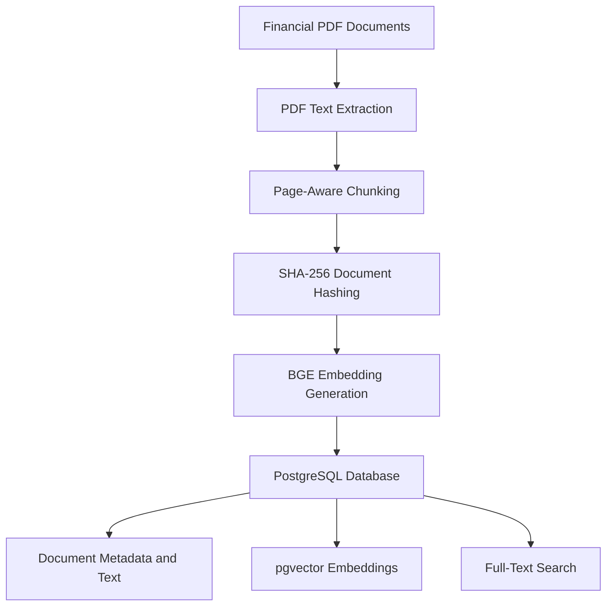
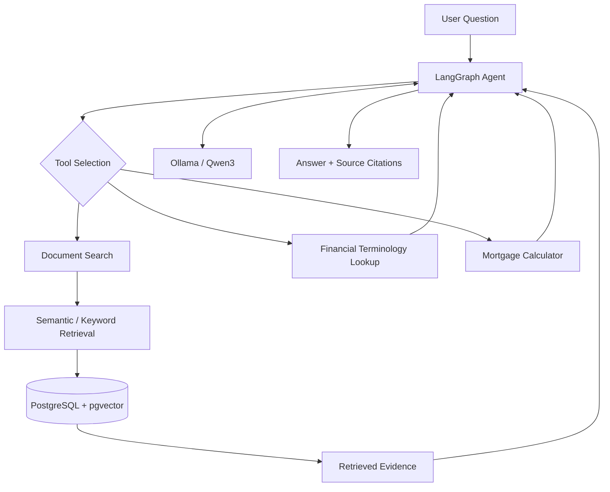

# FinGuard AI

### Financial Document Intelligence & Agentic RAG Platform

FinGuard AI is a Python-based financial document intelligence platform that combines Retrieval-Augmented Generation (RAG), agentic AI workflows, semantic search, and relational databases to answer questions about financial documents using retrieved evidence.

The project demonstrates backend software engineering, document processing, AI application development, retrieval evaluation, and automated testing.

## Project Status

**Active portfolio development.**

Core document ingestion, retrieval, agent orchestration, and evaluation capabilities have been implemented and tested.

The platform demonstrates production-oriented engineering practices but is not currently deployed as a production service.

## Key Features

### 1. Document Ingestion & Management

- PDF text extraction with page-level metadata
- Overlapping text chunking with source provenance
- SHA-256 hashing for duplicate document detection
- Transactional document update workflows
- PostgreSQL persistence using SQLAlchemy
- Database schema migrations using Alembic

### 2. Retrieval-Augmented Generation (RAG)

- Local embeddings using `BAAI/bge-small-en-v1.5`
- Semantic similarity search using PostgreSQL and pgvector
- PostgreSQL full-text keyword retrieval
- Cosine-distance filtering of retrieved evidence
- Grounded question answering using retrieved document context
- Abstention when sufficient supporting evidence is unavailable
- Document filename, page number, and chunk-level source attribution

### 3. Agentic AI

- LangGraph-based agent orchestration
- Local Qwen3 language model through Ollama
- Tool calling for:
  - Financial document search
  - Financial terminology lookup
  - Mortgage calculations
- Tool-routing safeguards
- Evidence-grounded answer generation
- Automated agent reliability testing

### 4. Backend Engineering

- Modular Python application architecture
- FastAPI REST endpoints
- PostgreSQL database integration
- SQLAlchemy ORM and Alembic migrations
- Automated tests using pytest
- Ruff linting
- GitHub Actions continuous integration

### 5. Retrieval Evaluation

- Evaluation dataset containing 20 financial-domain questions
- Dense semantic retrieval baseline
- PostgreSQL keyword retrieval baseline
- Retrieval evaluation metrics:
  - Precision@5
  - Recall@5
  - Mean Reciprocal Rank (MRR)
- Per-question retrieval results and relevant chunk IDs

The evaluation dataset uses provisional relevance annotations. Results are intended for development and comparison rather than production performance claims.

---

## System Architecture

FinGuard AI separates document ingestion from question answering.

### A. Document Ingestion Pipeline




The ingestion pipeline extracts text, preserves document provenance, generates embeddings, and stores document information in PostgreSQL.

### B. Agentic Question-Answering Workflow



The LangGraph agent coordinates model reasoning and tool execution. Document search retrieves supporting context from PostgreSQL, while specialized tools support terminology lookup and mortgage calculations.

The agent uses tool results to construct its response and includes document source references when applicable.

---

## Technology Stack

| Category | Technologies |
|---|---|
| Programming | Python, SQL |
| Backend | FastAPI, SQLAlchemy, Alembic |
| Agentic AI | LangGraph, Ollama, Qwen3 |
| Embeddings | BAAI/bge-small-en-v1.5 |
| Database | PostgreSQL, pgvector |
| Retrieval | Semantic similarity search, PostgreSQL full-text search |
| Document Processing | PDF extraction, chunking, SHA-256 hashing |
| Evaluation | Precision@5, Recall@5, MRR |
| Testing | pytest |
| Code Quality & CI | Ruff, GitHub Actions |

---

## Retrieval Evaluation

FinGuard AI includes an evaluation framework for comparing retrieval approaches.

### Evaluation Dataset

The evaluation dataset contains 20 financial-domain questions with associated relevant chunk IDs.

### Retrieval Approaches

**Dense Retrieval**

Uses BGE embeddings and pgvector cosine similarity to identify semantically relevant document chunks.

**Keyword Retrieval**

Uses PostgreSQL full-text search to retrieve chunks based on matching search terms.

### Evaluation Metrics

**Precision@5**

Measures the proportion of the top five retrieved chunks that are relevant.

**Recall@5**

Measures the proportion of relevant chunks retrieved within the top five results.

**Mean Reciprocal Rank (MRR)**

Measures how highly the first relevant result is ranked.

### Evaluation Files

```text
evals/
├── datasets/
│   └── retrieval_questions.json
├── evaluate_retrieval.py
├── inspect_chunks.py
├── inspect_keyword_retrieval.py
└── results/
    ├── dense_baseline.json
    └── keyword_baseline.json
```

The evaluation results provide a baseline for investigating retrieval quality and identifying opportunities for improvement.

**Note:** The dataset is small, and relevance labels are provisional. Results should not be interpreted as independently validated production benchmarks.

---

## Automated Testing

FinGuard AI includes automated tests for:

- PDF ingestion and document processing
- Duplicate document detection
- RAG service behavior
- Agent tool execution and reliability
- Retrieval evaluation metrics
- Database-related application behavior

### Run Tests

From the project root:

```bash
python -m pytest -q
```

### Run Selected Tests

```bash
python -m pytest -q tests/test_retrieval_metrics.py tests/test_agent_reliability.py tests/test_agent_tools.py tests/test_rag_service.py tests/test_duplicate_ingestion.py
```

The selected test suite passed with **16 tests passing** during the latest local validation.

---

## Local Development

### Prerequisites

- Python
- PostgreSQL
- pgvector extension
- Ollama
- Local Qwen3 model
- Project dependencies

### Environment Configuration

The repository includes an `.env.example` file with example database configuration values.

```env
DB_USER=finguard_app
DB_PASSWORD=your_password_here
DB_HOST=localhost
DB_PORT=5432
DB_NAME=finguard
```

Create a local `.env` file using your own configuration.

**Do not commit `.env` files or real credentials to GitHub.**

### Install Dependencies

Create and activate a Python virtual environment, then install the dependencies using the dependency configuration provided in the repository.

### Database Setup

Configure PostgreSQL, enable pgvector, and apply the project's Alembic database migrations before running database-dependent services.

### Local LLM

Install Ollama and make the required Qwen3 model available locally.

The application uses local model inference rather than requiring a hosted LLM API.

---

## Engineering Considerations

The project incorporates several reliability-oriented design choices:

- Document hashing to identify duplicate ingestion
- Transactional document updates
- Page-level provenance preservation
- Evidence filtering before answer generation
- Abstention when retrieved evidence is insufficient
- Agent tool-routing safeguards
- Automated regression testing
- Retrieval quality evaluation

These practices support reproducibility, maintainability, and safer AI-assisted document question answering.

---

## Current Limitations

- The platform is intended for local development and portfolio demonstration.
- Retrieval evaluation uses a small, provisionally labeled dataset.
- The system has not been independently validated for production financial decision-making.
- Local model quality and latency depend on the available hardware and model configuration.
- Production deployment, authentication, and enterprise-scale monitoring are not established by this project.

---

## Project Purpose

FinGuard AI demonstrates the integration of traditional software engineering with modern AI application development.

The project focuses on building reliable document intelligence workflows using Python, PostgreSQL, vector retrieval, agent orchestration, automated testing, and measurable retrieval evaluation.
